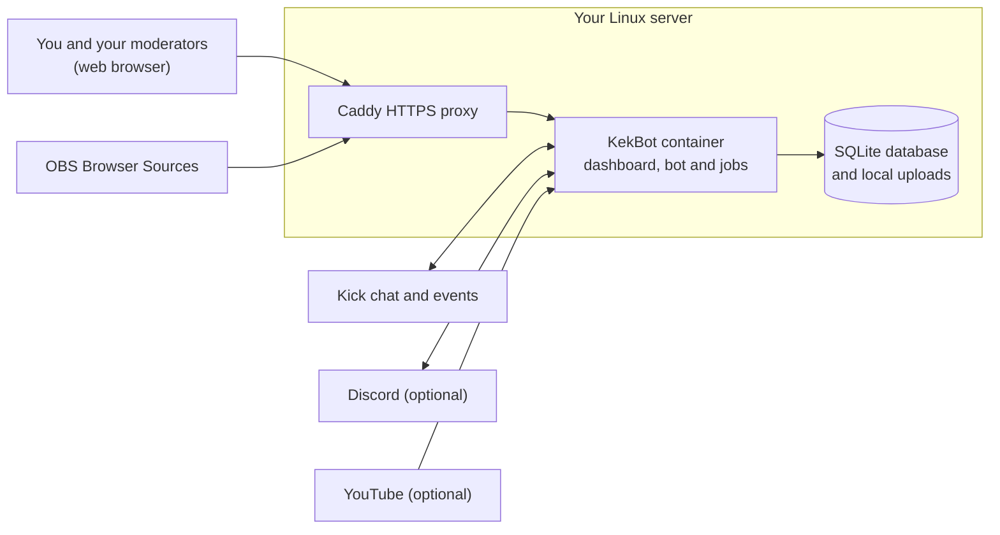

<div align="center">

# KekBot

**Your Kick chat, Discord team and OBS overlays in one self-hosted control room.**

[](https://github.com/DangerMouseUK/kekbot/actions/workflows/ci.yml) [](https://github.com/DangerMouseUK/kekbot/releases) [](LICENSE)

[Quick start](#quick-start) · [Features](#what-kekbot-does) · [Documentation](docs/README.md) · [Project status](#project-status) · [Contributing](CONTRIBUTING.md)

</div>

KekBot is a free, open-source stream bot for **Kick creators who run their community with Discord**. It answers chat commands, moderates chat, takes YouTube video requests, runs polls, raffles and a points-and-rewards system, and drives alerts and overlays in OBS. You and your moderators run it from one web dashboard, with everyday controls also available in Discord.

You run it yourself, on your own Linux server. There is no KekBot account to sign up for, no subscription and no project-run service between you and your viewers. Your settings, chat history and uploads stay in a local database and files that you own.

> [!IMPORTANT]
> **KekBot is in evaluation beta.** The latest published version is [v0.1.0-beta.4](https://github.com/DangerMouseUK/kekbot/releases/tag/v0.1.0-beta.4) (2026-10-10). Every feature below is implemented and covered by automated tests that use simulated providers. Real Kick, Discord and OBS delivery, public certificate renewal and installs by independent operators have **not** yet passed live acceptance, and there is no stable release. Start with a test installation and keep backups. [What beta means →](docs/BETA.md)

<!-- Screenshot placeholder: add a synthetic fixture capture of the dashboard Control room here once the owner approves an image. It must contain no real accounts, addresses, paths or tokens. -->

## What KekBot does

### 💬 Chat

- **Custom commands** with aliases, several random responses, counters, role limits and per-viewer or shared cooldowns, plus built-ins such as `!uptime`, `!so`, `!points`, `!vote` and `!sr`.
- **Timed messages** that post only while you are live, wait for chat activity and respect quiet hours.

### 🛡️ Moderation

- **Automatic rules** for links, phrases, repeated messages, capitals and message bursts, with trusted roles, escalation and a safe "test a message" preview.
- **Incident tools:** temporary lockdown presets, an emergency pause, warn, timeout, ban and delete actions, and private moderator notes.

### 🎵 Video requests

- Viewers request YouTube videos from Kick chat with `!sr`. You choose automatic or moderator approval, and moderators can approve from the dashboard or Discord.
- A persistent queue and a visible OBS player that pauses safely after a restart instead of skipping. Needs your own YouTube API key.

### 🎉 Community

- **Points and rewards:** points for active chatters while you are live, an estimated watch-time figure, rewards that moderators fulfil or refund, and leaderboards.
- **Polls, raffles and goals:** `!vote` and `!enter` from chat, role and points eligibility, draw and reroll, plus manual or event-driven goals.

### 📺 On stream (OBS)

- **18 Browser Source types**, including alerts with your own images and sounds, chat, event feed, goals, polls, raffles, leaderboards, countdowns, shoutouts and the media player.
- Each source has a private URL that you can revoke at any time. Built-in themes let you change the look without writing CSS.

### 🤝 Your team and Discord

- **Local accounts** with owner, admin, moderator and read-only roles, single-use invitations and scoped API tokens.
- **Discord** notifications routed to the channels you pick, and `/kekbot` slash commands for the roles or members you grant.

### 📊 Data and upkeep

- **Analytics** for observed streams, with CSV and JSON exports.
- **Retention settings**, per-viewer erasure, configuration export and import, snapshots before every update, and backup and restore tools.

The [user guide](docs/USER_GUIDE.md) explains each module. The [OBS guide](docs/OBS.md) covers sources and themes, and [release readiness](docs/RELEASE_READINESS.md) records what has been tested and how. Some dashboard, OBS and Discord improvements on `main` are newer than beta 4. They are listed under **Unreleased** in the [changelog](CHANGELOG.md).

## Why self-hosted

- **One creator per installation.** Each install serves one Kick channel and that creator's moderators. Nothing is shared with other streamers.
- **Your data stays local.** A SQLite database and local files on your server's disk hold settings, history and uploads. You decide what to keep with retention settings and exports.
- **No middleman.** No project-operated relay, account, subscription or billing. Kick, Discord and YouTube connect using applications and keys that you create and own.
- **Your secrets stay protected.** Provider credentials are encrypted with a separate installation key that you keep. Private OBS links and sessions can be revoked.
- **Open source under MIT.** Read it, change it and run it however you like.

New to these terms? The [glossary](docs/GLOSSARY.md) explains words such as *self-hosted*, *container* and *fixture* in plain English.

## Quick start

This is the short version of [Get your first KekBot running](docs/GETTING_STARTED.md). Use that walkthrough the first time: it covers each step, what success looks like and what to do if something fails.

**You need:**

- An always-on **Linux x86-64 server**. Ubuntu 24.04 LTS can install the prerequisites for you.
- An **administrator login** (`sudo` or root) and a terminal on that server, for example over SSH.
- For a live bot, a **public HTTPS address**: a domain pointing at the server, or its public IPv4 address. The bundled HTTPS proxy needs ports 80 and 443 open.
- The **Kick account** whose chat the bot should serve.

**1. Run the installer.** In Bash on your Linux server, copy and run both lines:

```sh
curl --proto '=https' -fsSLo install.sh https://raw.githubusercontent.com/DangerMouseUK/kekbot/main/install.sh &&
sudo bash install.sh
```

This downloads the official launcher and runs it with administrator access. Only run it if you trust the KekBot project. The launcher asks before it runs downloaded installation tools or installs missing packages. To inspect or pin the launcher first, see [advanced verification](docs/LAUNCHER.md#verify-a-versioned-launcher-download).

**2. Follow the guided choices.** Choose **Install a new instance**, enter `y` at **Open the guided setup?**, then choose **Recommended setup** and **Live creator installation**. Enter your domain or public IPv4 for HTTPS.

There is no stable release yet, so the wizard explains the evaluation limits and offers **Try v0.1.0-beta.4**. You must pick that option yourself: pressing Enter chooses **Stop for now**. Check **Review installation**, then type `APPLY`.

Recommended setup uses a published application image, so you don't need Node.js or a build step. It uses standard locations (`/srv/kekbot`, local port 3000). When it finishes, the installer shows **KekBot is ready for browser setup** and your web address.

**3. Claim your dashboard.** Open the address and paste the one-hour setup token. To read the token privately on the server, run `sudo cat /srv/kekbot/data/live/secrets/setup.token`. Then create your local owner account. This login is separate from your Kick login. There is no default account or password.

**4. Grow it one step at a time:**

1. [Connect Kick](docs/PROVIDERS.md#kick) and check one real reply in your chat.
2. [Add a welcome command and a cautious timer](docs/FIRST_SESSION.md).
3. [Add an OBS alert source](docs/OBS.md) and test it.
4. [Invite your moderators](docs/ACCOUNTS.md) with only the access they need.
5. Turn on [Discord, video requests and other modules](docs/USER_GUIDE.md) when you are ready.
6. [Keep a backup and a separate copy of your encryption key](docs/BACKUP_RECOVERY.md).

To update, stop, roll back or remove KekBot later, open the [management menu](docs/GETTING_STARTED.md#come-back-later).

### Want to look around first?

| Option | What you get |
| --- | --- |
| [Guided Linux demo](docs/GETTING_STARTED.md#try-a-demo-first) | The same installer with **Isolated fixture evaluation**: made-up data that never posts to Kick or Discord |
| [Windows or macOS demo](docs/DOCKER_DESKTOP.md) | A local evaluation in Docker Desktop. This is not a supported live host |
| [Developer demo](docs/QUICKSTART.md) | Run from source with the pinned Node.js and pnpm toolchain |

Need a custom version, an existing reverse proxy or manual Docker Compose? Use [Advanced setup](docs/LAUNCHER.md), the [installer reference](docs/INSTALLER.md) or [manual installation](docs/INSTALLATION.md).

## How it fits together



KekBot runs as **one application container** on a Linux x86-64 server. Docker runs it, and the installer handles the normal Docker setup for you. A bundled Caddy proxy can provide HTTPS for the dashboard and for provider callbacks. OBS shows KekBot pages through private Browser Source URLs.

ARM64, native Windows or macOS hosting, databases on network disks and multiple copies of the app are not supported. [Hosting details →](docs/INSTALLER.md#before-you-start) · [Architecture →](docs/ARCHITECTURE.md)

## Documentation

The [documentation hub](docs/README.md) lists every guide by task.

| I want to… | Read |
| --- | --- |
| Install my first bot | [Getting started](docs/GETTING_STARTED.md) → [Connect Kick](docs/PROVIDERS.md#kick) → [First session](docs/FIRST_SESSION.md) |
| Use the dashboard day to day | [User guide](docs/USER_GUIDE.md), [OBS and media](docs/OBS.md), [accounts](docs/ACCOUNTS.md) |
| Keep it running | [Updating](docs/UPDATING.md), [uninstalling](docs/UNINSTALLING.md), [operations](docs/OPERATIONS.md), [backup and recovery](docs/BACKUP_RECOVERY.md) |
| Fix a problem | [Troubleshooting](docs/TROUBLESHOOTING.md), then [open an issue](https://github.com/DangerMouseUK/kekbot/issues) |
| Look up a field, action or command | [Dashboard fields](docs/CONFIGURATION_FIELDS.md), [control actions](docs/API_ACTIONS.md), [CLI](docs/CLI.md), [configuration](docs/CONFIGURATION.md) |
| Understand the code | [Architecture](docs/ARCHITECTURE.md), [HTTP API](docs/API.md), [testing](docs/TESTING.md) |
| Look up a term | [Glossary](docs/GLOSSARY.md) |

## Project status

| Stage | Where things stand |
| --- | --- |
| **Published** | [v0.1.0-beta.4](docs/releases/v0.1.0-beta.4.md), an evaluation prerelease |
| **Built** | Milestones 1–17: the v1 feature set, the guided installer and the automated test campaign. Live acceptance of these features is still pending |
| **Still to do** | Live trials on new hosts with real providers and independent operators (Milestone 18), then the stable v1 release (Milestone 19) |

Passing automated tests does not prove real provider or OBS delivery, certificate renewal or an unaided installation. Those need live evidence. Follow progress in the [milestones](docs/MILESTONES.md), [roadmap](docs/ROADMAP.md), [release readiness](docs/RELEASE_READINESS.md) and [changelog](CHANGELOG.md).

## Contributing

Bug reports, focused fixes, clearer explanations and feedback from first-time installers are all welcome. Read [CONTRIBUTING.md](CONTRIBUTING.md) before opening a pull request. Beta testers can follow the [beta guide](docs/BETA.md#send-useful-safe-feedback) to send useful feedback safely.

## Security and privacy

Report vulnerabilities privately as described in [SECURITY.md](SECURITY.md). Never attach passwords, keys, setup tokens, private OBS URLs, databases or unreviewed logs to a public issue.

Database and asset backups do not include the installation encryption key, so keep a protected copy of the key somewhere else. [Privacy and retention →](docs/OPERATIONS.md#privacy-and-retention)

## License

KekBot and its built-in themes are released under the [MIT License](LICENSE). Dependencies keep their own licenses, and distributed packages include [third-party notices](docs/DEPENDENCIES.md). You are responsible for having the rights to assets you upload and media you play.
